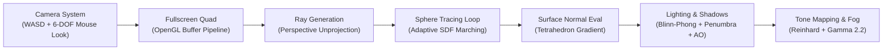

# Mini Ray Marcher

[](https://en.wikipedia.org/wiki/C%2B%2B17)
[](https://www.opengl.org)
[](https://www.khronos.org/opengl/wiki/OpenGL_Shading_Language)
[](LICENSE)

A real-time GPU Ray Marching engine built in modern C++17 and OpenGL 3.3 Core Profile. Evaluates 3D procedural geometry per-pixel via analytical Signed Distance Functions (SDFs), Constructive Solid Geometry (CSG), soft shadows, ambient occlusion, and Blinn-Phong lighting inside a fullscreen fragment shader.

---

## Architectural Overview



---

## Technical Features

- **Sphere Tracing Algorithm:** Marches primary rays along perspective camera vectors, adaptively stepping distances determined by the global scene distance field ($d = f(\mathbf{p})$).
- **Constructive Solid Geometry (CSG):**
  - Smooth polynomial minimum (`smin`) for organic blending and dynamic metaball morphing.
  - Boolean set operations: Union ($\min$), Subtraction ($\max(-d_a, d_b)$), and Intersection ($\max$).
- **Signed Distance Function Primitives:** Spheres, finite boxes, rounded boxes, toruses, cylinders, and infinite ground planes with procedural checkerboards.
- **Advanced Lighting Model:**
  - **Soft Ray-Marched Shadows:** March secondary shadow rays toward the light source with continuous penumbra estimation.
  - **Multi-Tap Ambient Occlusion (AO):** Evaluates distance field geometry along surface normals to darken crevices.
  - **Atmospheric Fog & Tone Mapping:** Exponential depth fog and Reinhard HDR tone reproduction with gamma 2.2 correction.
- **Multiple Curated Scenes:**
  1. *Morphing Blobs & CSG Shapes:* Dynamic metaballs orbiting with subtracted cubes and metallic toruses.
  2. *Precision CSG Architecture:* Cross-drilled blocks and Roman column formations.
  3. *Infinite Repetition:* Boundless hall of pillars generated via modulo domain repetition ($\mathbf{p} \bmod c$).

---

## Controls

| Input | Action |
| :--- | :--- |
| **Mouse Drag (Left/Right)** | Look around (Pitch and Yaw 6-DOF) |
| **W / A / S / D** | Fly camera forward / left / backward / right |
| **Space / Left Ctrl** | Fly camera upward / downward |
| **Left Shift (Hold)** | Boost camera flight speed |
| **1 / 2 / 3** | Switch active procedural scene |
| **L** | Toggle dynamic orbiting light source |
| **F** | Toggle ray-marched soft shadows |
| **O** | Toggle multi-tap ambient occlusion |
| **Escape** | Exit application |

---

## Prerequisites

- **Compiler:** GCC 9+, Clang 10+, or MSVC 2019+ (C++17)
- **Build System:** CMake 3.20+
- **Windowing:** GLFW 3 (`libglfw3-dev`)
- **OpenGL:** Development headers (`libgl-dev`)

---

## Build & Run

```bash
cd MiniRayMarcher
cmake -B build -S . -DCMAKE_BUILD_TYPE=Release
cmake --build build -j$(nproc)
./build/MiniRayMarcher
```

---

## License

Distributed under the [MIT License](LICENSE).
